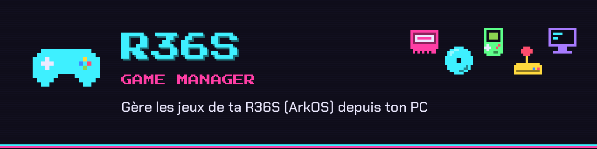
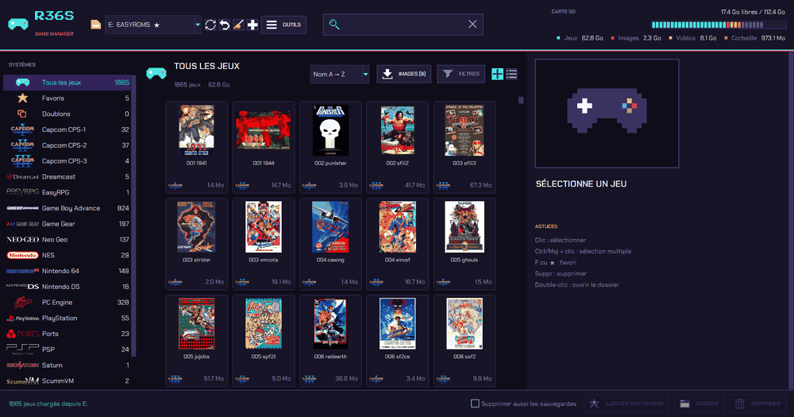
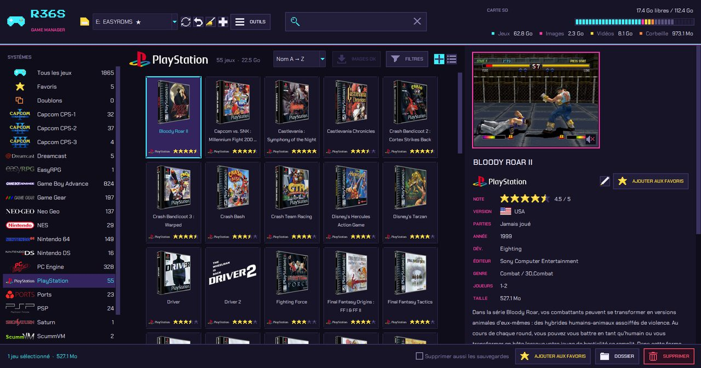
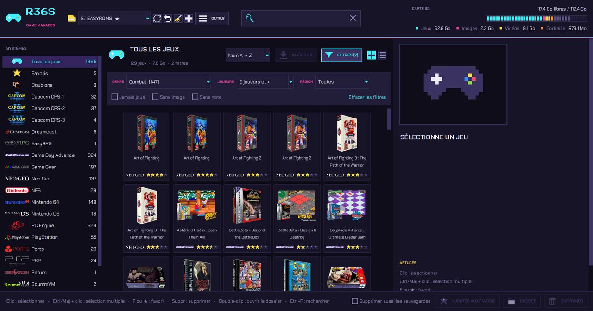

<p align="center">
  
</p>

<p align="center">
  
  
  
  
</p>

<p align="center">
  <b>Range, nettoie et embellis la carte SD de ta console R36S (ArkOS) depuis ton PC.</b><br>
  Jaquettes, vidéos, favoris, notes, nettoyage, compression… sans jamais toucher la ligne de commande.
</p>

<p align="center">
  
</p>

---

## ✨ Ce qu'il sait faire

| | |
|---|---|
| 🎮 **Bibliothèque** | Tous tes jeux en grille de jaquettes ou en liste, avec le **logo de chaque console**, la recherche et les **filtres** (genre, joueurs, région, jamais joué…) |
| 📺 **Fiche du jeu** | Capture, **vidéo** qui démarre toute seule, note ★, région avec drapeaux 🇫🇷🇺🇸🇯🇵, nombre de parties et date de la dernière |
| ⭐ **Favoris & fiches** | Les mêmes favoris que sur la console, modification de la fiche (nom, note, description, **images**) |
| ➕ **Ajout de jeux** | Glisse tes ROMs dans la fenêtre : la console est devinée, puis **image, description, année et genre sont cherchés sur internet** |
| 🧹 **Nettoyage** | Médias orphelins, fiches sans jeu, jeux dans le mauvais dossier, doublons, vidéos encombrantes |
| 💿 **Multi-disques & CHD** | Regroupe les jeux en plusieurs CD en une seule entrée `.m3u` et **compresse** les jeux CD en `.chd` (30 à 60 % de place gagnée) |
| 💾 **Sécurité** | Sauvegarde de tes parties sur le PC, vérification des BIOS, et **chaque opération s'annule** (corbeille) |

<p align="center">
  
  
</p>

## 📥 Télécharger

Va dans **[Releases](../../releases/latest)** et prends le fichier de ton système. Rien à installer :

| Système | Fichier |
|---|---|
| 🪟 Windows 10/11 | `R36S-Game-Manager-windows-x64.exe` (double-clic) |
| 🐧 Linux x64 | `R36S-Game-Manager-linux-x64.tar.gz` → décompresse puis `./R36S-Game-Manager` |

> **Optionnel :** [VLC](https://www.videolan.org) pour les vidéos des jeux, [7-Zip](https://www.7-zip.org) (Windows) ou `mame-tools` (Linux) pour la compression CHD.

## 🚀 Utilisation

1. **Éteins la console**, retire la carte SD et mets-la dans ton PC.
2. Lance le programme : la partition **EASYROMS** est trouvée automatiquement.
3. Gère tes jeux, puis remets la carte dans la console. C'est tout !

**Raccourcis :** `Ctrl+F` rechercher · `F` favori · `F2` modifier la fiche · `Suppr` supprimer · `F5` relire la carte · clic droit pour le menu du jeu.

> 🛟 **Pas de panique :** rien n'est effacé tout de suite. Les fichiers supprimés vont dans une corbeille cachée sur la carte, et le bouton ↶ annule la dernière opération. *Vider la corbeille* libère réellement la place.

## 🛠️ Depuis le code source

```bash
pip install -r requirements.txt
python app.py               # ou : lancer.bat (Windows) · sh lancer.sh (Linux)
python -m pytest -q         # tests sur une fausse carte (la tienne n'est jamais touchée)
python build.py             # fabrique l'exécutable dans dist/
```

Pour publier une version : `git tag v1.0.0 && git push --tags`. GitHub Actions teste le code et fabrique les exécutables Windows et Linux dans *Releases*.

<details>
<summary>🗂️ Organisation du code</summary>

| Fichier | Rôle |
|---|---|
| `app.py`, `tools_actions.py` | Fenêtre principale et actions des menus |
| `widgets.py`, `dialogs.py` | Boutons, grille de jaquettes, fenêtres |
| `core.py` | Lecture de la carte et des `gamelist.xml`, suppression, déplacement |
| `journal.py` | Corbeille et annulation de toutes les opérations |
| `cleanup.py`, `multidisc.py`, `chd.py`, `saves.py`, `bios.py` | Outils |
| `scraper.py`, `metadata.py`, `net.py` | Images, fiches et accès internet |
| `theme.py`, `icons.py`, `logos.py`, `systems.py`, `regions.py` | Thème rétro, icônes pixel, logos, consoles, drapeaux |

</details>

## 🙏 Crédits

Images : [libretro-thumbnails](https://github.com/libretro-thumbnails/libretro-thumbnails) · Fiches : [libretro-database](https://github.com/libretro/libretro-database), [Wikidata](https://www.wikidata.org) et [Wikipédia](https://fr.wikipedia.org) · Compression : `chdman` de [MAME](https://www.mamedev.org) · Vidéos : [VLC](https://www.videolan.org) · Polices : *Press Start 2P* et *Chakra Petch* (licence OFL).

> ⚠️ Aucune ROM ni aucun BIOS n'est fourni. Les logos des consoles sont lus dans les thèmes déjà présents sur ta carte.
> Projet indépendant, sans lien avec les fabricants de la R36S ni avec ArkOS.

Sous licence [MIT](LICENSE).
